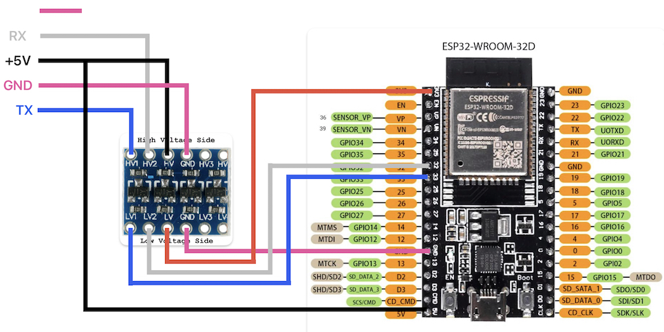
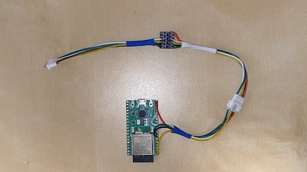
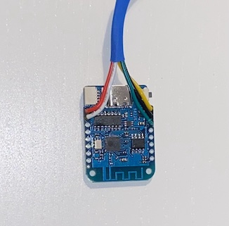
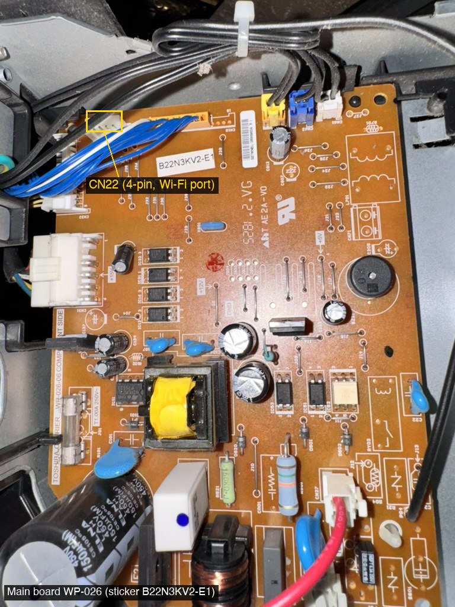
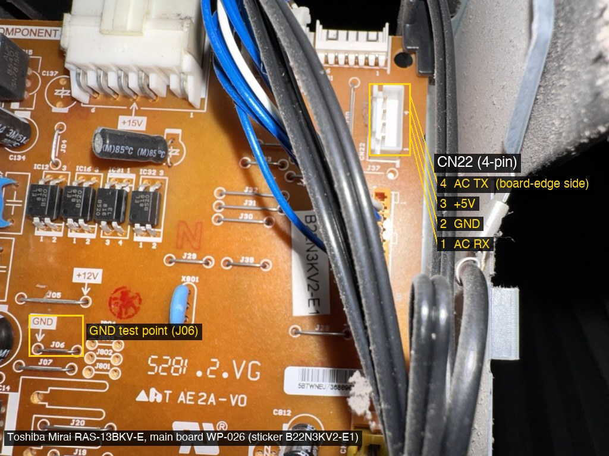
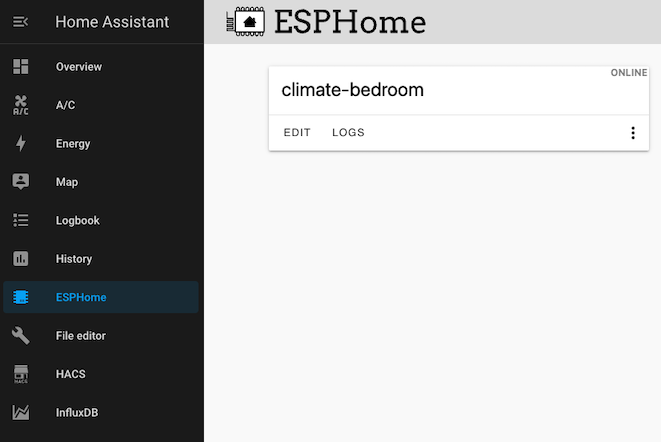
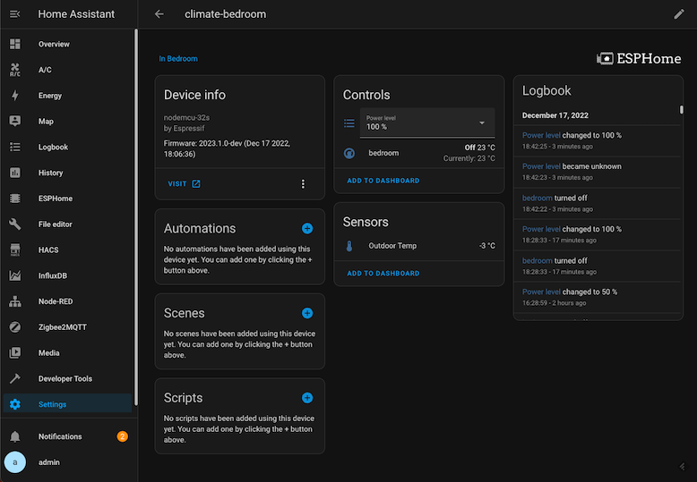
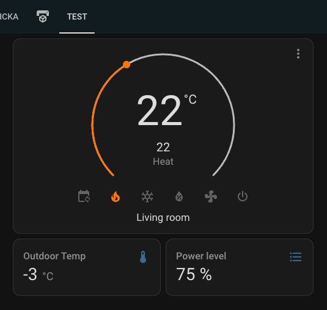

# ESPHome component for Toshiba AC

Should be compatible with models Toshiba Suzumi/Shorai/Seiya and other models using the same protocol.

Toshiba air conditioner has an option for connecting remote module purchased separately. This project aims to replace this module with more affordable and universal ESP module and to allow integration to home automation systems like HomeAssistent.

This component use ESPHome UART to connect with Toshiba AC and communicates directly with Home Assistant.

## ESPHome versions
Current main branch supports latest ESPHome **2026.1**. There have been some internal changes in climate entity in ESPHome which makes it incompatible with previous ESPHome versions.

If you use ESPHome **2025.10 or earlier**, use tag `2025.10` like this:

```
external_components:
  - source: 
      type: git
      url: https://github.com/pedobry/esphome_toshiba_suzumi
      ref: "2025.10"
    components: [toshiba_suzumi]
    refresh: 1min
```
If you use ESPHome **2025.11 or 2025.12**, use tag `2025.12` like this:

```
external_components:
  - source: 
      type: git
      url: https://github.com/pedobry/esphome_toshiba_suzumi
      ref: "2025.12"
    components: [toshiba_suzumi]
    refresh: 1min
```

These older version won't be maintained, I'd recommend to upgrade to ESPHome 2026.1

## Supported Toshiba units

Any unit which have an option to purchase a WiFi adapter RB-N105S-G/RB-N106S-G:

* Seiya RAS-B24 J2KVG-E
* Suzumi Plus RAS-B18, B22 and B24 PKVSG-E
* Shorai Premium RAS-B18, B22 and B24 J2KVRG-E
* Daiseikai 9 RAS-B10, B13 and B16 PKVPG-E
* Shorai Edge RAS-B07, B10, B13, B16, B18, B22 and B24 J2KVSG-E
* Seiya RAS-B10, B13, B16 and B18 J2KVG-E
* Suzumi Plus RAS-B10, B13 and B16 PKVSG-E
* Mirai RAS-13BKV-E (4-pin CN22, see [Pinout](#pinout))
* Shorai Premium RAS-B10, B13 and B16 J2KVRG-E
* SHORAI CURVE RAS-B13P2KVSG, RAS-B10P2KVSG

#### 2026 units
It seems that some 2026 units ship already with new built-in wifi module (SHORAI CURVE RAS-B13P2KVSG, RAS-B10P2KVSG). This adapter is model WRE-T00BJ10 based on RTL8710C (ARM Thumb). Seems to have the same funtionality as RB-N105S-G/RB-N106S-G and can be replaced by custom ESP adapter.

## Hardware

* tested with ESP32 (WROOM 32D)
* tested with ESP8266 (Lolin D1 mini)
* connection adapter can be used the same as with this solution (https://github.com/toremick/shorai-esp32).
* Alternatively, you can use only a level shifter between 5V (AC unit) and 3.3V (ESP32) (search Aliexpress for "level shifter"). That's what I use and it works fine.

### ESP32 (WROOM 32D)

   

   Please pay attention to correctly wire the level shifter - it must have both High Voltage (5V and GND from the AC unit) and Low Voltage (3.3V and GND from ESP) connected.
  

   

### ESP 8266EX (Lolin D1 mini)

   

### Pinout

AC unit has a wifi connector CN22 with an extension cable, usually with pink and blue colors (see the schema above).

<p align="center">

|pin number| color | ESP32 pin  |ESP8266 pin|
|----------|-------|------------|-----------|
|    1     |🟦 blue  | 33 (TX)    | 13 (TX)   |
|    2     |🟪 pink  | GND        | GND       |
|    3     |⬛️ black | \+5V (Vin) | \+5V (Vin)|
|    4     |⬜️ white | 32 (RX)    | 12 (RX)   |
|    5     |🟪 pink  | **do NOT use** | **do NOT use** |

</p>

The matching connector is JST PA2.0 ([Aliexpress](https://www.aliexpress.com/item/1005007176563512.html))

#### Units with a 4-pin CN22 (2017/2018 models)

Some 2017/2018 units have only a 4-pin CN22 on the main board and no extension cable. Toshiba listed them as Wi-Fi ready with adapter RB-N102S-G plus cable 43T60480, which maps CN22 pins 1-4 straight to the adapter's pins 1-4 (pin 5 goes elsewhere). The pinout of pins 1-4 is the same as above: 1 = AC RX, 2 = GND, 3 = +5V, 4 = AC TX.

Confirmed working on a Mirai RAS-13BKV-E with main board WP-026 (sticker B22N3KV2-E1, the same board family as Suzumi RAS-B10/B13/B16/B18/B22 N3KV2-E1):

<p align="center"> </p>


- GND and +5V are the two middle pins; +5V is the one nearer the board edge. The silkscreen marks pin 1 (next to J37) and pin 4. Pin 4 (AC TX) is the outermost pin at the board edge, pin 1 (AC RX) the innermost. Check with a multimeter (continuity to the board's GND test point, unit unplugged) before connecting.
- Power, mode, fan, swing on/off and setpoint work in both directions; outdoor temperature, power level and self-clean are reported.
- Not available on this unit: room temperature (0xBB reads 127), Hi POWER and ECO (0xF7 neither answered nor acted on), fixed louver positions (acknowledged but ignored), energy and ODU/IDU data.

‼️‼️<br>
**WARNING: Do NOT connect PIN 5 (the outermost pink wire) to anything. Double check that you have wired the ESP device correctly. Only connect and disconnect the ESP while the AC unit is disconnected from main power. Shorts or wrong wiring will damage AC unit board.**<br>
‼️‼️

## Installation

1. install Home Assistant and [ESPHome Addon](https://esphome.io/guides/getting_started_hassio.html)

2. add new ESP32 device to ESPHome Dashboard. This will flash the device and create a basic configuration of the node.

   

3. edit code configuration and setup UART and Climate modules. See [example.yaml](https://github.com/pedobry/esphome_toshiba_suzumi/blob/main/example.yaml) for configuration details.

```yaml
...
external_components:
  - source: 
      type: git
      url: https://github.com/pedobry/esphome_toshiba_suzumi
    components: [toshiba_suzumi]

uart:
  id: uart_bus
  tx_pin: 33
  rx_pin: 32
  parity: EVEN
  baud_rate: 9600

# Optional. Needed for the energy / power sensors (the unit clock is set from it).
# time:
#   - platform: homeassistant
#     id: hass_time

climate:
  - platform: toshiba_suzumi
    name: living-room
    id: living_room
    uart_id: uart_bus
    #time_id: hass_time  # Optional. Enables energy / power on units that have them.
...
```

That is all that is needed: the component finds out what the unit supports and creates the
matching Home Assistant entities and presets (see [Automatic feature detection](#automatic-feature-detection)).
Every option below is optional and only needed to rename an entity or to override detection:

```yaml
climate:
  - platform: toshiba_suzumi
    ...
    #auto_detect: false      # Turn detection off: only what is listed here is created (old behaviour)
    #time_sync_interval: 24h # Clock sync interval. Default 24h. Set to 0 to sync only at startup.
    #disable_wifi_led: true  # Keep the indoor-unit Wi-Fi LED off (EPC 0xDE/0xDF).
    # Entities. Listing one always shows it, with your name; otherwise it is created
    # with a default name and shown only when the unit supports it.
    #indoor_temp:            # Not created automatically (the climate entity shows the room temperature)
    #  name: Indoor Temp
    #outdoor_temp:
    #  name: Outdoor Temp
    #power_select:
    #  name: "Power level"
    #vertical_air_direction: # Fixed louver position (Toshiba "horizontal louver", air up/down)
    #  name: "Vertical air direction"
    #ionizer:                # Ionizer / air purifier on/off (EPC 0xC7)
    #  name: "Ionizer"
    #self_clean:             # Post-shutdown self-cleaning status
    #  name: "Self Clean"
    #off_timer:              # ON while the OFF timer set on the remote is running
    #  name: "Off timer"
    #off_timer_remaining:    # Minutes until the OFF timer switches the unit off
    #  name: "Off timer remaining"
    #error_code:             # Fault code reported by the unit ("none" when OK)
    #  name: Error Code
    #energy:                 # Daily energy consumption (Wh), needs time_id
    #  name: "Daily Energy"
    #power:                  # Estimated real-time power (W), needs time_id
    #  name: "Realtime Power"
    #fcu_model / fcu_serial / fcu_firmware / cdu_model / cdu_serial / cdu_firmware: unit information
    #cdu_load / cdu_iac / cdu_td_temp / cdu_ts_temp / cdu_te_temp: outdoor unit diagnostics
    #fcu_tc_temp / fcu_tcj_temp / fcu_fan_rpm: indoor unit diagnostics
    # Climate features. Setting one replaces the detected value.
    #horizontal_swing: true  # Offer horizontal swing
    #disable_heat_mode: true # Cooling-only unit
    #min_temp: 5
    #supported_presets:      # Exactly these presets. "Sleep" and "Comfort" are never detected
      #- "Standard"          # (they have no capability bit), list them here if your remote has them.
      #- "Hi POWER"
      #- "ECO"
      #- "Fireplace 1"
      #- "Fireplace 2"
      #- "8 degrees"         # The temp range is then 5-30°C
      #- "Silent#1"
      #- "Silent#2"
      #- "Sleep"
      #- "Floor"
      #- "Comfort"
```

The component is automatically installed directly from Github during compilation.

When configured correctly, new ESPHome device will appear in Home Assistant integrations and you'll be asked to provide encryption key (it's in the node configuration from step 2.). All entities then populate automatically.



You can then create a Thermostat card on the dashboard.



### Automatic feature detection

The component finds out what the unit supports from:

- the unit identification bytes in the handshake (logged as the unit profile),
- the unit's feature mask, EPC `0xEE` (special modes, cooling-only / heating-only, horizontal louver, energy, fixed louver positions, ionizer),
- which properties the unit answers (outdoor temperature, power level, self-clean, OFF timer, fault code) and which status messages it sends (indoor / outdoor diagnostics, unit information).

Presets: units that report a feature mask get "Standard", "ECO" and "Hi POWER", plus "8 degrees", "Fireplace 1/2", "Silent#1/#2" and "Floor" when the mask has them. Units without the mask get no special modes. "Sleep" and "Comfort" are not in the mask and are offered only when you list them in `supported_presets`.

Home Assistant reads entities and presets only when it connects, and ESPHome can hide entities only at startup. The result is therefore stored in flash and applied at the next start: **the first time (and whenever something new is found) the device restarts once**, about 30 seconds after connecting to the unit. You will see `Unit capabilities changed ... Restarting` in the log. For the same indoor unit features are only added, never removed. To detect again from scratch (e.g. after moving the ESP to another unit, which is also detected automatically by model and serial), call `id(living_room).reset_capabilities();` from a button lambda.

On ESP8266 the stored result survives restarts but not a power cut unless `esp8266: restore_from_flash: true` is set; without it the device simply detects again after power is restored.

### Temperature range (8 °C mode / FrostGuard)
Homeassistant thermostat component is by default set with a range of 17-30°C.
If your unit has the "8°C operation" (frost protection), the range is 5-30°C (detected automatically, or add "8 degrees" to `supported_presets`):
- a target temperature below 17°C turns 8 °C mode on (5-16°C, as Haori units do from their own remote; Seiya units accept only 5-13°C in this mode) and switches the unit to Heat (the mode heats only),
- a target temperature of 17°C or more turns it off,
- selecting the "8 degrees" preset sets 8°C, leaving it sets 20°C (unless the current target already fits the new mode).

The setpoint and the special mode are always sent together, so the unit never keeps an 8 °C mode setpoint (temperature + 16 on the wire) after the mode changes. On units that report a feature mask they go out in one `0xF8` frame (mode, setpoint, fan and special mode).

## Filtering incorrect values (127 / 254 / 255)

The component automatically filters out incorrect sensor readings at the code level:
- Temperature readings of `127` (which the unit transmits when it cannot measure the temperature or when it is off) are ignored.
- Compressor load and current values of `254` or `255` are also ignored.

Therefore, you do not need to add manual filters in your YAML configuration for these values. However, if you need to filter out other values, you can still add ESPHome filters like this:

```yaml
    outdoor_temp:
      name: Outdoor Temp
      filters:
        - filter_out: 127
```

### Vertical air directions

Some units support fixed vertical air directions in addition to vertical swing. ESPHome's native climate swing modes are limited to `off`, `vertical`, `horizontal`, and `both`, so fixed positions are exposed as a Home Assistant select entity:

```yaml
    vertical_air_direction:
      name: "Vertical air direction"
```

In Toshiba service documentation this corresponds to the horizontal louver, which controls vertical air direction.

The select provides `Off`, `Swing`, `Top`, `Middle Top`, `Middle`, `Middle Bottom`, and `Bottom`.

### Self-cleaning status

Some Toshiba units run a post-shutdown self-cleaning cycle. During this cycle the indoor fan can continue running even though the climate entity is off. Configure the optional `self_clean` binary sensor to enable self-clean detection and expose the cycle in Home Assistant:

```yaml
    self_clean:
      name: "Self Clean"
```

The climate entity remains OFF while self-cleaning is active. ESPHome climate entities do not have a self-cleaning mode or action, so the binary sensor reports this separate operating state. Without `self_clean`, the component does not query self-clean status and retains its existing climate behavior.

How the cycle behaves (per the Toshiba service manual):

- It runs only after cooling or dry operation, and only if that ran for at least 10 minutes; it then runs for a fixed ~30 minutes. It does not run after heating, fan-only, or a short (<10 min) cooling/dry run.
- During the cycle the indoor fan runs at low speed to dry the unit; the compressor stays off. The unit reports itself as not operating, which is why the climate entity is OFF.
- The service manual documents enabling/disabling the self-clean cycle as a unit-side procedure (the indoor unit's `RESET` button together with a remote-control diagnosis code). `0xCB` is the ECHONET "self-cleaning function setting", but the meaning of the Toshiba bits for writing is not known, so this component reports the cycle but does not control it.

### OFF timer

The OFF timer set on the IR remote can be shown in Home Assistant:

```yaml
    off_timer:
      name: "Off timer"
    off_timer_remaining:
      name: "Off timer remaining"
```

`off_timer` follows register 0x94, which the unit pushes when the timer starts or ends. `off_timer_remaining` reads register 0x96 (two bytes: hours and minutes) and reports minutes. The unit doesn't push 0x96, so it is polled at the component's update interval while the timer runs, and reported as 0 when no timer is set. The unit updates 0x96 in coarse steps (a 30 min timer read 0:30, then 0:15). Setting the timer from Home Assistant isn't supported.

### Error code

The optional `error_code` text sensor shows the fault code reported by the unit:

```yaml
    error_code:
      name: "Error Code"
```

Property `0x88` (ECHONET "fault status") tells whether a fault is present, and only then
the 9-byte property `0x86` (manufacturer's fault code) is read. The sensor shows `none` when there is no fault, or the
code byte in hex (for example `0x1C`). The full `0x86` data is written to the log as a
warning. The mapping of these codes to the codes shown on the remote (E01, F02, ...) is not
known yet.

## Unit model information

`fcu_model` and `fcu_serial` come from the handshake. The outdoor unit (CDU) model, serial and firmware, and the indoor unit firmware, come from a model-info message (EPC `0xE0`) that the unit sends on its own. These sensors stay empty until the unit sends that message, and some units may never send it. When it arrives, everything it carries is also logged and shown in `dump_config`.

## Outdoor/Indoor unit diagnostics (ODU/IDU sensors)

Some Toshiba AC units send extended status messages from the outdoor unit (ODU, EPC `0xE5`) and indoor unit (IDU, EPC `0xE4`). These messages contain diagnostic data such as compressor load, refrigerant temperatures, and fan speed. The component can parse these and expose them as optional sensors.

**Available sensors:**

| Sensor | Description | Unit |
|--------|-------------|------|
| `cdu_load` | Compressor load, derived from the compressor frequency byte (raw / 1.7) | % |
| `cdu_iac` | Compressor current / EEV actuation | A |
| `cdu_td_temp` | CDU discharge pipe temperature | °C |
| `cdu_ts_temp` | CDU suction pipe temperature | °C |
| `cdu_te_temp` | CDU evaporator temperature | °C |
| `fcu_tc_temp` | FCU heat exchanger temperature | °C |
| `fcu_tcj_temp` | FCU heat exchanger junction temperature | °C |
| `fcu_fan_rpm` | FCU fan speed | RPM |

These sensors are all optional — only add the ones you need to your YAML configuration. On units of profile 3 the component polls `0xE4` / `0xE5` after connect and on each update interval; other units publish the values only when they push a status frame. With automatic detection the sensors appear once the unit has sent them.

### Native Energy and Power monitoring

If your AC unit supports it, you can now get native energy consumption data. This requires adding a `time` component to your configuration so the component can sync the current time with the AC unit.

```yaml
time:
  - platform: homeassistant
    id: hass_time

climate:
  - platform: toshiba_suzumi
    # ...
    time_id: hass_time
    energy:
      name: "Daily Energy"
    power:
      name: "Realtime Power"
```

The `power` sensor provides a real-time estimate in Watts, calculated from the rate of change in the AC's internal energy counters.

The daily energy register (`0xD8`) holds 24 hourly values bucketed by the unit's own clock. Until the clock is set, the unit reports zeros, so `energy` and `power` stay at 0. Only units that support energy reporting answer `0xD8` (with automatic detection the sensors appear only on such units).

How the clock is set:

- The component first sends a weekly-schedule frame (EPC `0x99`) with the current date and time and an empty schedule. Most units accept it. Note that it also clears a weekly schedule stored in the unit by the Toshiba app.
- Some units ignore `0x99` completely, for example the Carrier 40WHP (Toshiba Haori). If there is no acknowledgement within 15 seconds, the component sends the plain clock frame (EPC `0x98`) instead and keeps alternating until one of them is acknowledged: four quick attempts, then one every 5 minutes.
- The format that worked is used for the periodic sync (`time_sync_interval`, default 24 h), and the clock is synced again after the UART link is re-established.

Look for `AC unit acknowledged time synchronization (EPC 0x99)` or `(EPC 0x98)` in the log. If neither appears, your unit most likely has no clock / energy support.

### Estimating power consumption (Fallback)

For older units that do not support the native energy registers, you can still estimate power using `cdu_load`. `cdu_load` reports the compressor load as a percentage, which correlates with power usage. You can combine it with your unit's rated power input to estimate consumption in Home Assistant using a template sensor:

```yaml
sensor:
  - platform: template
    sensors:
      ac_estimated_power:
        friendly_name: "AC Estimated Power"
        unit_of_measurement: "W"
        value_template: "{{ (states('sensor.compressor_load') | float(0)) / 100 * 880 }}"
```

Replace `880` with your unit's rated power input in watts (check the datasheet). You can then use the [HA Riemann sum integral integration](https://www.home-assistant.io/integrations/integration/) to track energy consumption over time.

## Protocol analysis

What is known about the UART protocol is described in [PROTOCOL.md](PROTOCOL.md): the frame
format, the handshake, the ECHONET Lite properties of the home air conditioner object
(`01 30 01`) and the Toshiba-specific ones, and which of them this component implements.

Short summary:

- 9600 baud, 8E1. Frames are `STX(02) | FT(u16) | CN | FN | DL(u16) | FD | FCC`, where FCC
  is the two's complement of the sum of all bytes except STX.
- After the handshake, all climate traffic uses `FT=0x0003` with the home air-conditioner
  object `01 30 01`:
  - Get: `CN=0x10`, `FD = 01 30 01 00 01 <EPC>`
  - Set: `CN=0x10`, `FD = 01 30 01 00 02 <EPC> <value>`
  - Reply: `CN=0x90`, `FD = 01 30 01 00 00 <len u16> <EPC> <data>`
  - Notify from the unit (IR remote, internal change): `CN=0x11`, `FD = 01 30 01 <len u16> <EPC> <data>`,
    acknowledged with `CN=0x91`.
- The identity reply in the handshake carries the indoor unit model and serial and four
  identification bytes.

### Reporting an issue

The component logs how it classified the unit after connect:

```
[I][ToshibaClimateUart]: Unit profile 3 level 2 (00 01 01 02)
[I][ToshibaClimateUart]: Unit feature mask 0xEE: 6C 03
[I][ToshibaClimateUart]: Unit capabilities 0x0F6BF (applied 0x0F6BF)
```

Please include these lines (and your model) when reporting an issue. If the identity reply
never arrives, the component falls back to reading the basic climate status (logged as
`No unit identity; loading basic status without diagnostics`).

### References

- [maxmacstn/ToshibaCarrierController](https://github.com/maxmacstn/ToshibaCarrierController) — handshake indexing and model-info offsets
- [ormsport/ToshibaCarrierHvac](https://github.com/ormsport/ToshibaCarrierHvac) — earlier community UART library

## Links

https://www.espressif.com/en/products/devkits/esp32-devkitc/

https://github.com/toremick/shorai-esp32

https://github.com/Vpowgh/TConnect

Discord channel: https://discord.gg/wYYFawvqfr
